  <a href="https://linkedin.com/in/hitaarnavbhatia">LinkedIn</a> ·
  <a href="mailto:bhatiahitaarnav@gmail.com">bhatiahitaarnav@gmail.com</a>

<!-- Cards are drawn by scripts/render_readme_cards.py and refreshed daily by .github/workflows/readme-cards.yml -->
